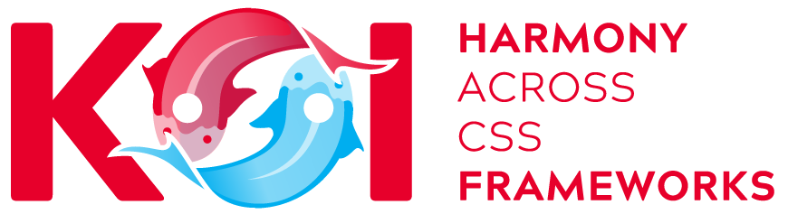

# Connect.Koi - Styling with multiple CSS Frameworks

Koi is a solution for CMS components to dynamically adjust their output to the CSS-Framework of the current page. In other words, a component can ask the page "what CSS framwork are you using?" and vary the output accordingly.

It currently has an implementation for 
* [DNN/DotNetNuke 10.1+](https://github.com/dnnsoftware/Dnn.Platform)
* [Oqtane 2](https://oqtane.org/)

 We would appreciate implementations for [Umbraco](https://github.com/umbraco/Umbraco-CMS), [NopCommerce](https://github.com/nopSolutions/nopCommerce), [Orchard](https://github.com/OrchardCMS/Orchard), [OrchardCore](https://github.com/OrchardCMS/OrchardCore) and other .net platforms.

## How to install & use

Depending on your needs or the CMS-Framework you're targeting, you will do different things. All is documented on [connect-koi.net](https://connect-koi.net/).

## For .net 4.8 & .net Core / Standard 2.0 and DNN 10.1+

Koi is built to run with

* .net Framework 4.8
* .net 6 & 7
* .net Standard 2.0
* DNN 10.1+ (as an installable module)
* Oqtane (ATM as part of 2sxc)

The root project **Koi** with the namespace **Connect.Koi** will compile to .net Framework 4.8, .net Standard 2.0, .net 6 and .net 7. If you want to contribute an implementation for another CMS, this is where you start.

The testing project **Connect.Testing.Koi** runs unit-tests on Connect.Koi.

The DNN implementation **Connect.Dnn.Koi** extends Koi with the detection mechanisms as they are needed in the platform [DNN / DotNetNuke](http://www.dnnsoftware.com/) and generates an installable ZIP package for DNN 10.1+.

---

## History

### Version 1.0

This was created in early 2018 to assist in building Dnn Modules and Apps which would look great in various Themes having different CSS frameworks. 

### Version 2.0

To enable Koi to also work on Oqtane we changed the detection system to build on Dependency Injection. This was implemented in April 2021. 

### Version 3.1

Retargeted to DNN 10.1.0 and .net Framework 4.8, and aligned every shared dependency with the versions a DNN 10.x host ships in its `bin` - none of them are deployed with the module any more. This raises the minimum DNN version: sites on DNN 9.x must stay on Koi 3.0.